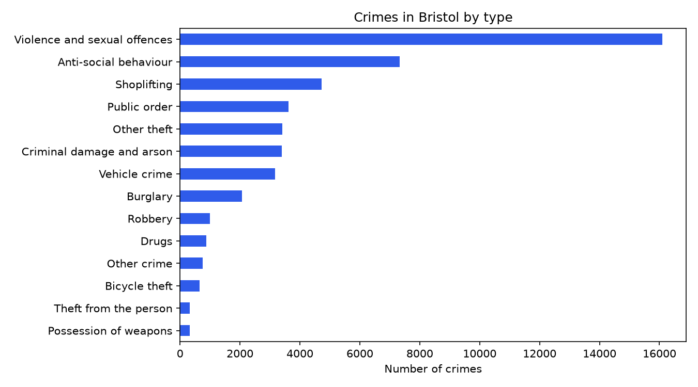
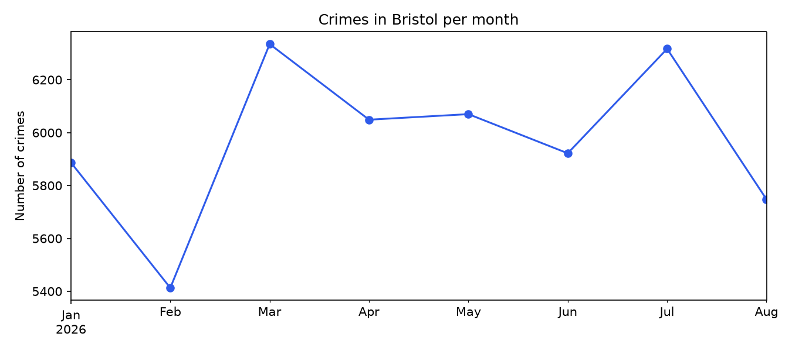
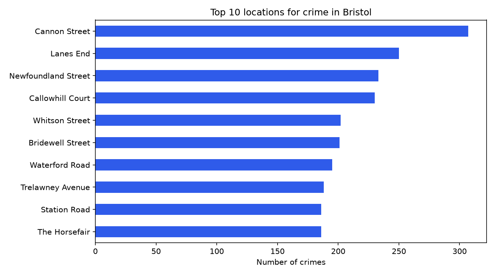
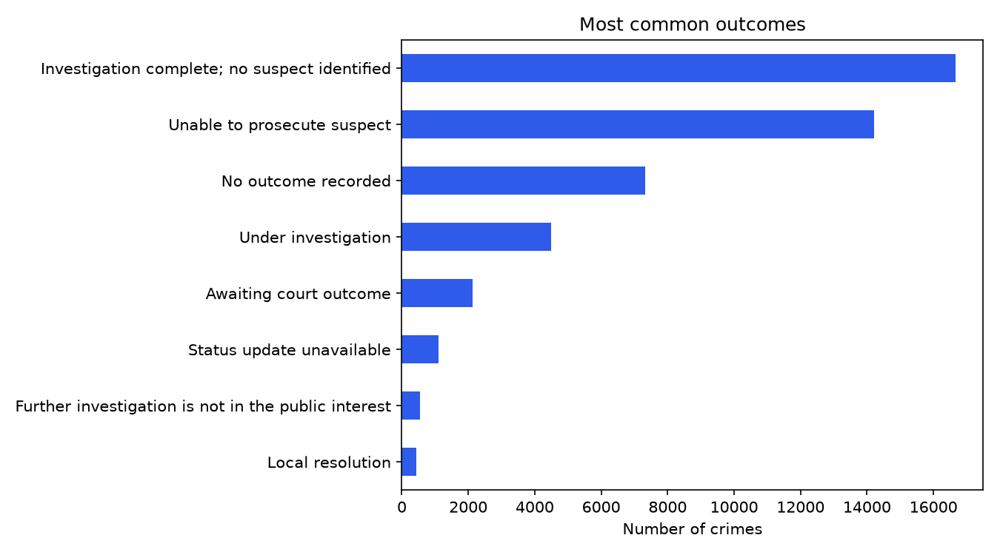

# Bristol Crime Analysis

A Python project that analyses street-level crime in Bristol using open data from [data.police.uk](https://data.police.uk/) (Open Government Licence v3.0).

## Questions this project answers
- Which crime types are most common in Bristol?
- How does the number of crimes change month by month?
- Which locations have the most crimes?
- What happens after a crime is reported (outcomes)?

## Tools
Python, pandas, matplotlib

## How to run
1. Download the data: go to https://data.police.uk/data/, choose **Avon and Somerset Constabulary**, select the months you want, tick **Include crime data**, and download.
2. Unzip the files and put the `*-street.csv` files in the `data/` folder.
3. Install the libraries: `pip install -r requirements.txt`
4. Run: `python analysis.py`

The charts are saved in the `charts/` folder.

## What the code does
1. **Load** all the CSV files into one table.
2. **Clean** the data: fix dates, keep Bristol only, remove duplicates and missing values.
3. **Analyse** crime by type, month, location and outcome.
4. **Visualise** the results as charts.

## Key findings
- Analysed 47,741 street-level crimes in Bristol between January and August 2026, using open data from data.police.uk.
- Violence and sexual offences were the most common crime type (34% of all crimes).
- March 2026 was the busiest month (6,335 crimes) and February the quietest (5,413), although February also has fewer days.
- Cannon Street had the most crimes of any named street (307). Locations are approximate, because police.uk moves each crime to a nearby point to protect privacy.

## Charts

``

## Data source
Street-level crime data from data.police.uk, published under the Open Government Licence v3.0. Crime locations are approximate, not exact addresses.
